<p align="center">
  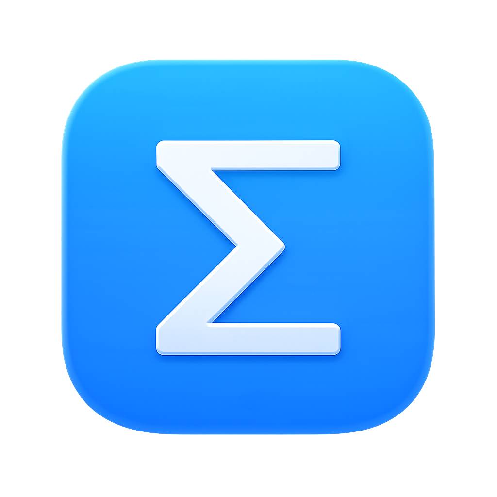
</p>

<h1 align="center">Token Monitor for Android</h1>

<p align="center">
  <a href="https://github.com/The-Minion-oOo/token-monitor-android/releases/latest">Download APK</a> ·
  <a href="docs/PAIRING.md">Pair with your desktop</a> ·
  <a href="docs/WIDGETS.md">Widgets</a> ·
  <a href="CHANGELOG.md">What changed</a>
</p>

<p align="center">
  <a href="https://github.com/The-Minion-oOo/token-monitor-android/actions/workflows/android.yml"></a>
  
  
  
  <a href="LICENSE"></a>
  <a href="https://github.com/The-Minion-oOo/token-monitor-android/releases"></a>
</p>

<p>
  <a href="docs/images/hero-light.png#gh-light-mode-only">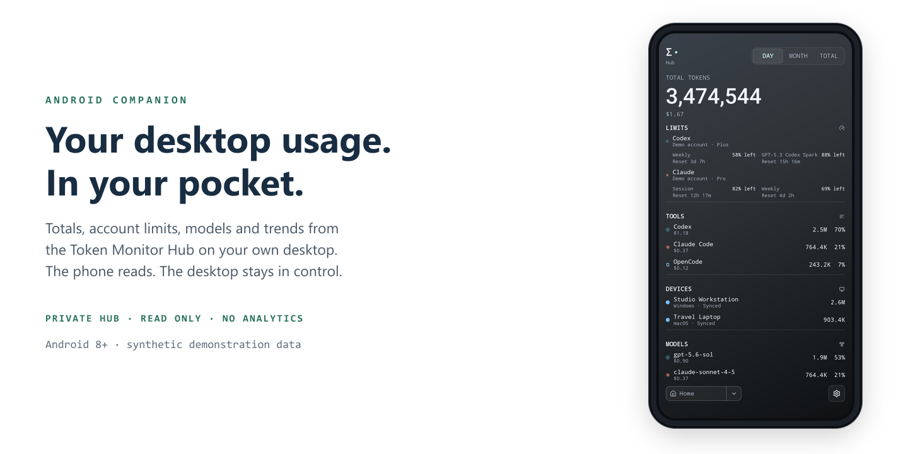</a><a href="docs/images/hero-dark.png#gh-dark-mode-only">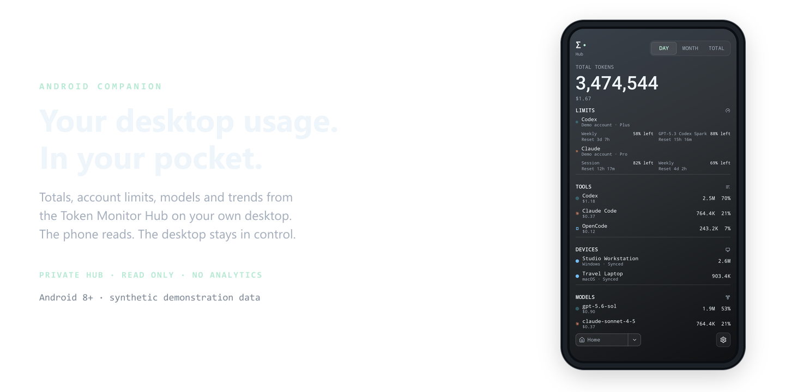</a>
</p>

## The desktop dashboard, made mobile

<table>
  <tr>
    <td align="center" valign="top" width="33%"><a href="docs/images/home.png">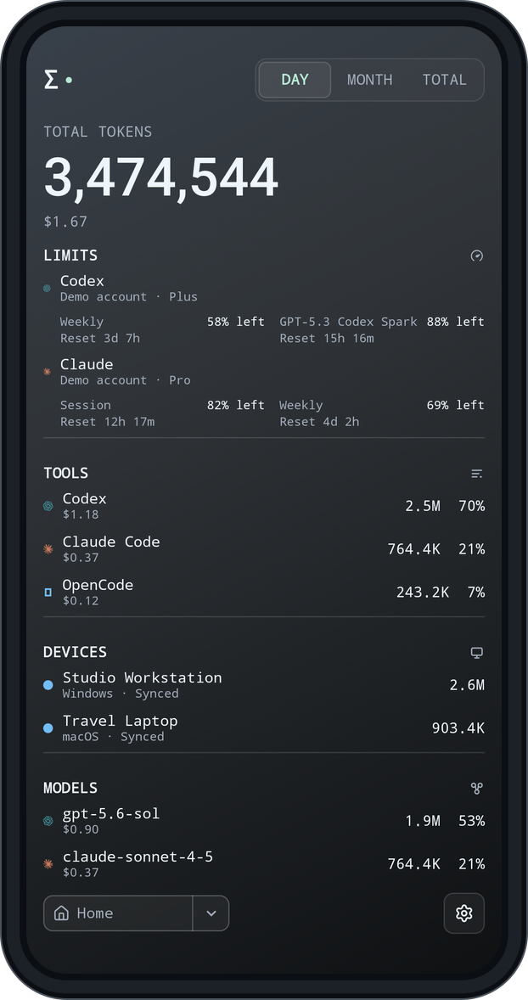</a><br><b>Command center</b><br>Totals, limits, tools, devices, models</td>
    <td align="center" valign="top" width="33%"><a href="docs/images/filtered-models.png">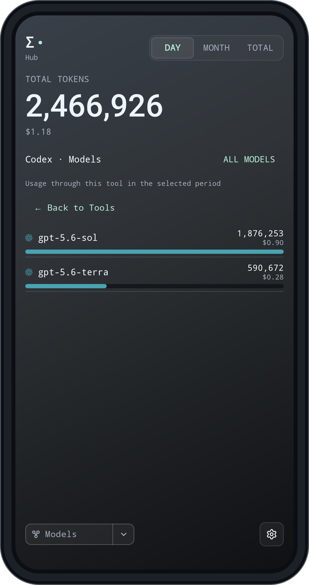</a><br><b>Tap a tool</b><br>See the models behind it</td>
    <td align="center" valign="top" width="33%"><a href="docs/images/trends.png">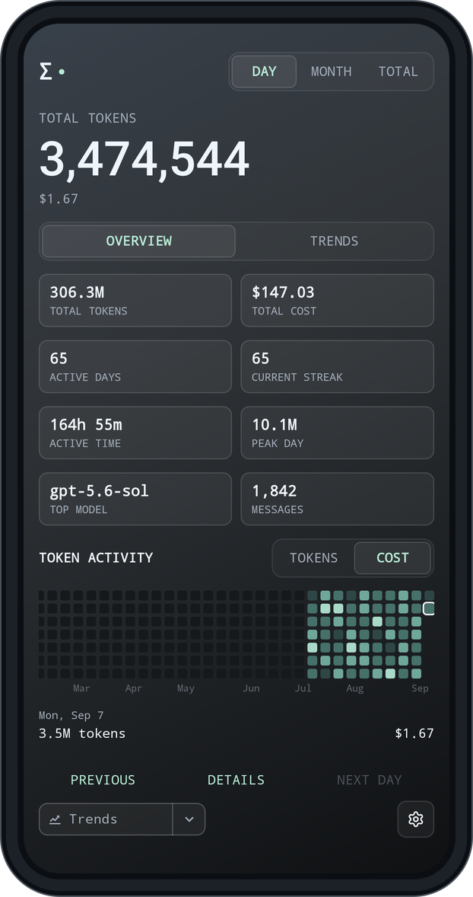</a><br><b>Find the busy days</b><br>Cards, heatmap, daily series</td>
  </tr>
  <tr>
    <td align="center" valign="top" width="33%"><a href="docs/images/devices.png">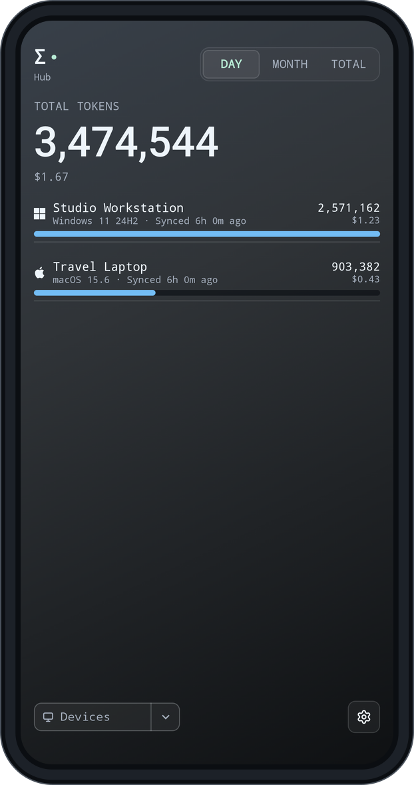</a><br><b>Every desktop</b><br>What each machine contributes</td>
    <td align="center" valign="top" width="33%"><a href="docs/images/projects.png">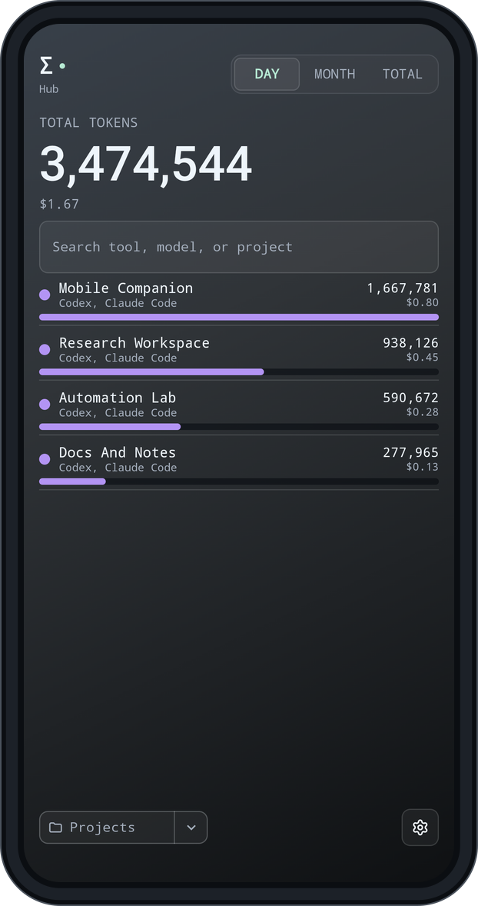</a><br><b>Projects and sessions</b><br>Searchable, without transcripts</td>
    <td align="center" valign="top" width="33%"><a href="docs/images/settings.png">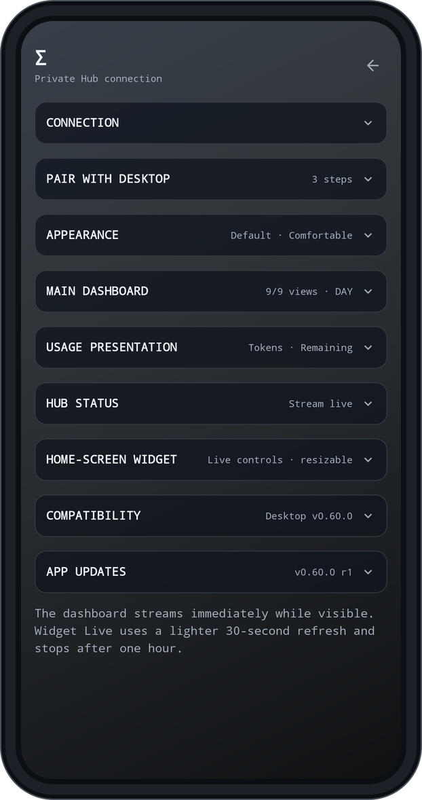</a><br><b>Make it yours</b><br>Themes, text size, motion, views</td>
  </tr>
</table>

> Every image is a capture of the Android app using made-up accounts, devices,
> projects, and usage. Capture instructions are in the [development guide](docs/DEVELOPMENT.md#showcase-captures).

## One fixed card, four focused pages

<table>
  <tr>
    <td align="center" valign="top" width="50%"><a href="docs/images/widget-pages-overview.png">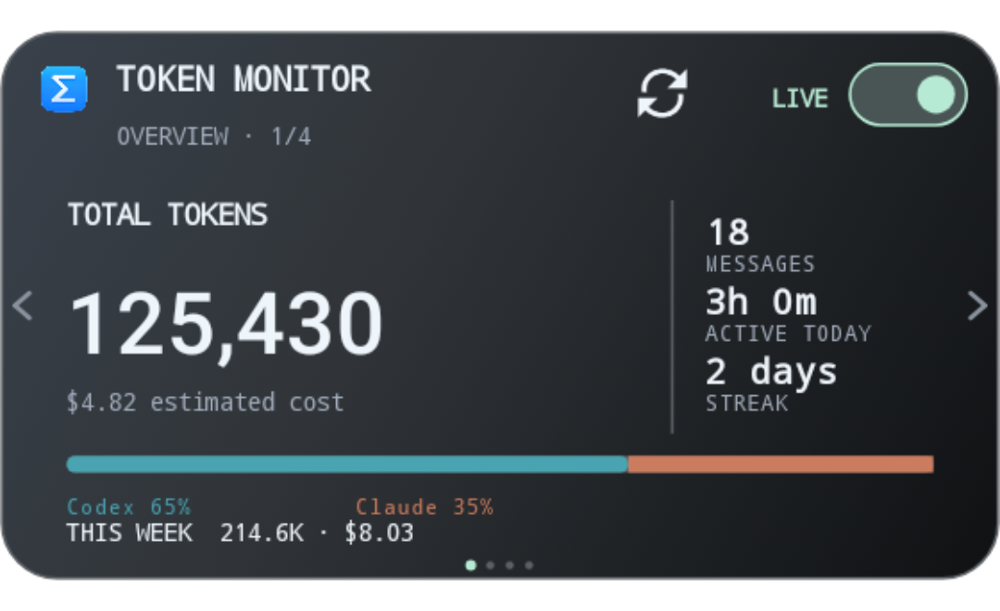</a><br><b>Overview</b><br>Totals, cost, activity and tool share</td>
    <td align="center" valign="top" width="50%"><a href="docs/images/widget-pages-limits.png">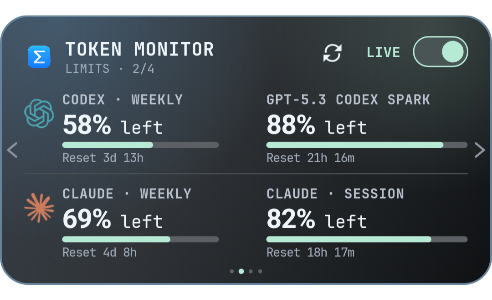</a><br><b>Limits</b><br>Account windows and reset times</td>
  </tr>
  <tr>
    <td align="center" valign="top" width="50%"><a href="docs/images/widget-pages-breakdown.png">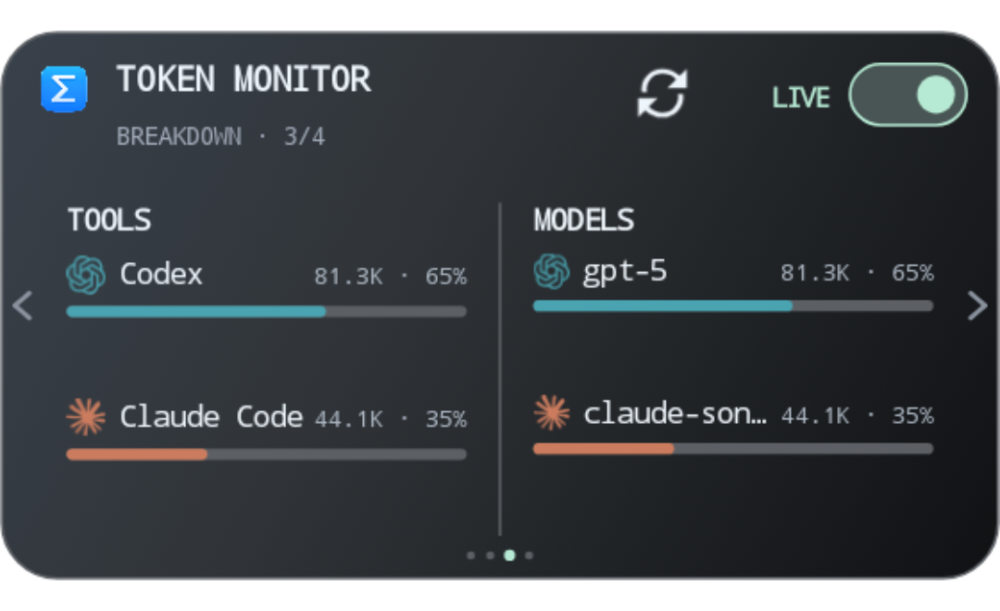</a><br><b>Breakdown</b><br>Leading tools and models</td>
    <td align="center" valign="top" width="50%"><a href="docs/images/widget-pages-activity.png">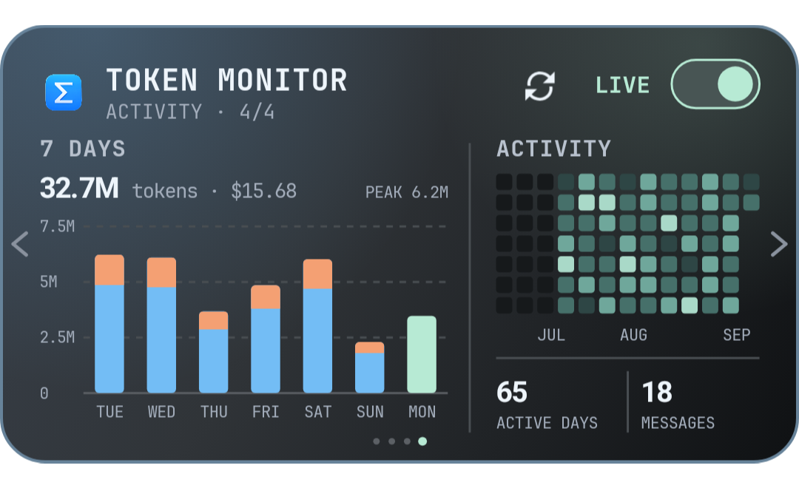</a><br><b>Activity</b><br>Daily chart and activity heatmap</td>
  </tr>
</table>

**Token Monitor · Pages** has four manually selected pages in one fixed
composition. Tap the left or right edge to switch pages; page changes stay local.
It requests a wide 4×2 placement and fits the same layout into the space provided
by your launcher.

The picker also includes **Token Monitor · Usage**, a responsive summary widget
that reflows as you resize it. Both widgets follow the app's theme.

### Keep widgets current without opening the app

- **Refresh** fetches one update.
- **Live** checks stats every 30 seconds for up to one hour, with a Stop control
  on the widget and its notification.
- **Background refresh** optionally checks every 30 or 60 minutes. It starts
  **Off**, with **Wi-Fi only** on, and shows no notification. Android may delay
  runs while the phone sleeps.

Choose background refresh under **Settings → Home-screen widget**. Failed reads
keep the last snapshot and mark it stale; changing pages never starts a fetch.

[Widget guide](docs/WIDGETS.md) · [Background refresh and data use](docs/WIDGETS.md#background-refresh)

## Get started

Your desktop usage, wherever you check it. Choose how your phone reaches the
[Token Monitor](https://github.com/Javis603/token-monitor) Hub:

<table>
  <tr>
    <td align="center" valign="top" width="33%"><b>Tailscale</b><br>At home and away, over your private network.<br><b>Recommended</b><br><a href="#tailscale-setup"><kbd>Set up Tailscale</kbd></a></td>
    <td align="center" valign="top" width="33%"><b>Home Wi-Fi</b><br>A direct connection on your home network.<br>Optional · home only<br><a href="#home-wi-fi-setup"><kbd>Set up home Wi-Fi</kbd></a></td>
    <td align="center" valign="top" width="33%"><b>Internet (HTTPS)</b><br>Reach an existing HTTPS Hub without Tailscale.<br>Optional · off by default<br><a href="#internet-https-setup"><kbd>Set up HTTPS</kbd></a></td>
  </tr>
</table>

**Install first:** on Android 8 or newer, download the signed APK from
[Releases](https://github.com/The-Minion-oOo/token-monitor-android/releases/latest).
Already installed? Use **Settings → App updates**.

### Tailscale setup

1. Install [Tailscale](https://tailscale.com/) on the desktop and phone, and sign
   both into the same tailnet.
2. In desktop Token Monitor, open **Settings → Multi-device Sync** and choose
   **Host hub on this device**. Keep Token Monitor running.
3. Copy the desktop's Tailscale address (`100.x`) and Hub secret into Android,
   then tap **Connect**.

### Home Wi-Fi setup

1. Connect the desktop and phone to the same home network. In desktop Token
   Monitor, enable **Host hub on this device** under **Settings → Multi-device Sync**.
2. For a home-only connection, enable **Use Wi-Fi as the main Hub address** in
   Android, enter the desktop's private address and Hub secret, then tap **Connect**.
3. Already paired through Tailscale? Add a **Home Wi-Fi URL** instead. Tap **Find**,
   then **Test and save home address** to keep it as an optional fallback.

Allow Android's local-network permission if prompted. The home route is for your
private network; use Tailscale or an HTTPS Hub when away.

### Internet HTTPS setup

1. Set up a Hub separately: the desktop project's Cloudflare Worker Hub, or a Node
   Hub behind an HTTPS reverse proxy with a valid certificate.
2. In Android connection settings, enable **Allow an internet Hub over HTTPS**.
   This separate permission starts **off**.
3. Enter the public DNS name, such as `https://hub.example.com`, and Hub secret,
   then tap **Connect**. A bare name gains HTTPS and defaults to port 443.

The switch does not expose your computer, open a port or deploy a Hub. A Worker
uses outbound desktop connections; a public reverse proxy deliberately exposes
its Hub. Use a long random secret: it can also change Hub data. If the phone is
lost, change that secret on the Hub and every connected desktop.

[Installation and updates](docs/INSTALL.md) · [Pairing and connection options](docs/PAIRING.md)

## What it shows

| View | Content |
| --- | --- |
| Home | Token and cost totals, account limits, tools, models, devices and recent sessions |
| History and trends | Day, week, month and custom ranges; activity heatmaps and charts by tool or model |
| Projects and sessions | Searchable usage, running sessions and available context, speed and cache details |
| Accounts and services | Provider allowances, reported spend and wallet balances, subscriptions and service status |
| Appearance | Default, Obsidian and Porcelain themes, desktop theme codes, text size and motion controls |
| Dashboard layout | Reorderable views and Home modules, tool filters and adjustable row counts |

Missing prices remain explicit rather than silently becoming zero. Details
appear only when the desktop Hub provides them; the app does not collect usage
or read prompt and response bodies itself.

[Desktop feature coverage](docs/DESKTOP_PARITY.md)

## Connection and privacy

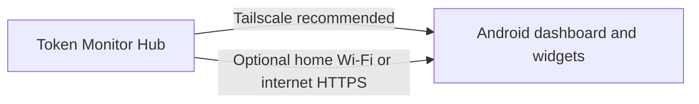

- The app reads Hub data; it cannot change desktop settings, usage or files.
- Hub secrets use an Android Keystore-backed store and are excluded from backups.
- Home Wi-Fi and internet HTTPS access are separate opt-ins. Internet Hubs require
  a public DNS name and HTTPS.
- No ads or analytics. Background widget refresh starts Off; dashboard streaming
  ends when it is no longer visible unless an explicit widget Live session is active.
- App update checks are manual. Downloaded APKs are verified before Android asks
  to install them; there is no silent installation.

Session titles are shared only with desktop and device consent and never appear
on widgets. Turning off **Show session titles** hides received titles on the
phone; it does not erase the local snapshot cache or change desktop consent.

[Privacy and security](docs/SECURITY.md) · [Report a concern](SECURITY.md)

## Compatibility and validation

| | |
| --- | --- |
| Current release | [Android v0.78.0 r4](https://github.com/The-Minion-oOo/token-monitor-android/releases/tag/android-v0.78.0-r4) |
| Desktop baseline | [Token Monitor v0.78.0](https://github.com/Javis603/token-monitor/releases/tag/v0.78.0) |
| Minimum Android version | Android 8.0 |

R4 adds optional background widget refresh. Checks covered the signed upgrade,
an overnight preview run and physical reboot restoration. A matching battery
baseline was not measured; test details and limits belong in
[Validation](docs/VALIDATION.md).

Android-only updates increment the release revision while keeping the verified
desktop version. [Upstream pin](upstream.json) · [Release notes](CHANGELOG.md)

## Build and contribute

Use JDK 17 or newer, Android SDK 37 and the bundled Gradle wrapper:

```powershell
.\gradlew.bat :app:testDebugUnitTest :app:lintDebug :app:assembleDebug
```

Add `-PtokenMonitorPreview=true` for a separate preview installation that leaves
the release app's pairing untouched.

[Development guide](docs/DEVELOPMENT.md) · [Contributing](CONTRIBUTING.md)

## Documentation

| Using it | Understanding it | Maintaining it |
| --- | --- | --- |
| [Installation](docs/INSTALL.md) | [Architecture](docs/ARCHITECTURE.md) | [Development](docs/DEVELOPMENT.md) |
| [Pairing](docs/PAIRING.md) | [Hub protocol](docs/PROTOCOL.md) | [Validation](docs/VALIDATION.md) |
| [Widgets](docs/WIDGETS.md) | [Desktop parity](docs/DESKTOP_PARITY.md) | [Releasing](docs/RELEASING.md) |
| [Privacy](docs/SECURITY.md) | [Widget design](docs/WIDGET_DESIGN.md) | [Following upstream](docs/UPSTREAM_SYNC.md) |

I maintain this project independently of the upstream Token Monitor maintainers
and the services whose marks appear in the app.
[MIT License](LICENSE) · [Third-party notices](THIRD_PARTY_NOTICES.md).

<p align="center">
  Made with ❤️ by <a href="https://github.com/The-Minion-oOo"><b>The_Minion_oOo</b></a><br>
  <sub>...: Thanks to Codex and Claude :...</sub>
</p>
