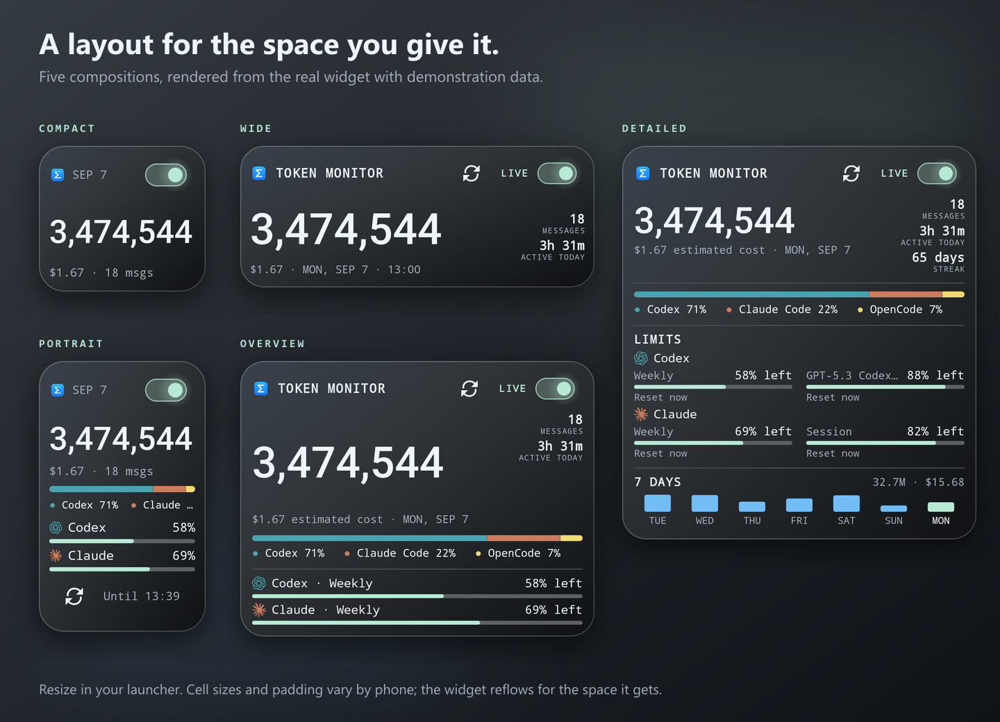

# Home-screen widgets

Add Token Monitor from your launcher's widget picker. The existing responsive widget
starts at 2×2 cells and is also available from Settings → Home-screen widget. A
separate **Token Monitor · Pages** entry requests 4×2 and shows four manually
selectable information pages. Long-press the original Usage widget and use the
launcher's resize handles to change its shape. The Pages widget is fixed-layout:
some launchers may still expose handles, but it always fits the same 1.82:1 card
instead of switching to another composition.

## What fits where

| Layout | Minimum content space | Content |
| --- | --- | --- |
| Compact | 110×110 dp | Date and the Live toggle, the full count, cost and message count; with more height, the tool split and the tightest window, then a Refresh icon with the saved time |
| Wide | 240×116 dp | Brand header with Refresh, status and the toggle; count, cost and date beside two stats |
| Portrait | 110×240 dp | Compact content plus a second provider window |
| Overview | 240×190 dp | Brand header, count with two stats beside it, tool split, the tightest window (a second from 221 dp), and the seven-day chart from 301 dp |
| Detailed | 250×384 dp | Overview content plus three stats, every limit window with its reset in two columns, and the week total on the chart |

The Pages widget requests a 4×2 placement. Launchers may allocate a different
physical size or cell count, but that does not create a responsive Pages layout.
Its fixed manual order is **Overview → Limits → Breakdown → Activity**. All four
pages are rendered from one saved or Live snapshot into identical 1.82:1 full-card
images. The launcher receives only the selected image, so it cannot shrink or fan
the pages as a collection. Tap the left or right edge to change the active page;
the four dots show its position. Page changes never start a request, timer,
auto-rotation loop, or wake lock.

| Page | Content |
| --- | --- |
| Overview | Total tokens, estimated cost, messages, active time, streak, tool share, and week summary |
| Limits | Up to four tightest account windows with remaining quota and reset or expiry wording |
| Breakdown | Ranked tool and model totals with proportional bars and provider colors |
| Activity | Labeled seven-day token and cost bars, a labeled 13-week heatmap, active days, and messages |

When the Hub reports unpriced tokens, cost slots show the known subtotal with
`+ ?`, or `— (?)` when no priced subtotal is available. Accessibility descriptions
include the unpriced count. This does not change the card's geometry or type sizes;
older Hub snapshots without the optional count keep their existing cost labels.

The complete four-page gallery is shown in the project [README](../README.md#one-fixed-card-four-focused-pages).

These are content dimensions, not launcher cells. Pixel, One UI and other launchers
size their cells differently and add their own padding, so the same 2×2 request can
land in Compact on one phone and Portrait on another. Larger system text raises the
height the Portrait, Overview and Detailed layouts need; a widget that no longer fits
drops to the next layout down rather than clipping.

The widget is set in the dashboard's own type: monospace labels and section titles,
a tabular sans-serif figure, and the same `Reset 1d 13h` countdowns the app shows.
The card takes the launcher's system corner radius on Android 12 and newer. Quota
bars and the seven-day chart are drawn at the exact pixel size the launcher reports
for the widget, so nothing is scaled after the fact and edges stay sharp at any size.
All four pages share the same text roles and supporting-label contrast. Long names
truncate instead of forcing a smaller page-specific type scale, and sparse Breakdown
data remains top-aligned rather than stretching across the card.

Stats beside the figure are today's messages and active time from the Hub's history,
the current streak, and the week's tokens when a day has none of those. The tool bar
splits today's tokens by tool in the vendor colors the app uses. The detailed layout
lists every reported window, two per provider, with the tightest first; the smaller
layouts show the lowest remaining window for each of up to two providers, which is
what the dashboard's Home module leads with. Percentages are remaining quota
as the Hub reports it; they are not inferred from token costs. A window under 35 percent
turns orange and under 15 percent red, matching the app. If the Hub supplies no limits,
the widget says so. The chart uses calendar days ending on the snapshot date; a dash
marks a day with no recorded data rather than a measured zero.

## Saved, Refresh and Live

Both widget providers follow the app's appearance settings. Desktop `TM1-…`
codes supply the original four colors; `TM2-…` codes add an independent chart
color for seven-day bars and activity heatmaps. Vendor-colored tool/model bars
keep their own attribution colors. Pasting a theme code does not change the
Pages widget's fixed composition or require a new Hub fetch.

The controls live in the header: a refresh icon with no visible button circle and a
Live toggle. Both retain 48 dp touch targets. The
toggle's knob sits left and grey while Live is off, and right with a soft glow in the
accent color while a session is connected. Tapping anywhere else on the card opens
the app.

| State or action | What happens |
| --- | --- |
| Saved | Shows the last received snapshot with its time beside the toggle. No widget-owned connection is active. |
| Refresh | Starts one bounded fetch and stops after completion or a 45-second timeout. |
| Live | Reads current Hub stats every 30 seconds for up to one hour while the dashboard is closed. |
| Stop | Tap the toggle again, or Stop in the notification. The dashboard can still stream while it is open. |

The label beside the toggle reads `LIVE` in the accent color while a session is
connected, `CONNECTING` or `UPDATING` while one is in progress, and `SAVED · 18:17`
otherwise. The narrow layouts drop the label and keep the toggle. Accessibility labels carry the full state and
the saved timestamp. Figures come from the snapshot date, which may be older than
today when the phone has been offline; Live does not invent intermediate readings,
and the count rolls only when the total actually changes.

While a session runs, its notification carries the figure, cost, and the
tightest window per provider with its reset. It labels reconnecting sessions and
shows the age of saved data, avoiding a Today label for an older snapshot. It is
updated only when visible content changes. On
Android 16 it is a promoted ongoing notification, which is what One UI shows under
"Live notifications" and on the lock screen, with a status bar chip carrying the
compact figure. Tap it to open the app; Stop ends the session.

The widget is also eligible for the lock screen on launchers that offer third-party
widgets there. Whether yours does depends on the launcher, not the app.

On Android 13 and newer, starting Live or Refresh asks for notification permission
once, so the Stop control has somewhere to live. Declining leaves the dashboard and
saved widgets working. A killed process, the hour expiring, or removing the last
widget ends the session. Live does not automatically restart. The separate
optional background job is described below; there is no app wake lock or page rotation.

The hour includes time spent asleep. Waking the phone after expiry does not
extend the session, and Refresh does not restart its clock. The repository checks
the deadline before each widget-owned request. On Android 17, a home-only pairing
also needs local-network permission; a configured Tailscale route can work
without that optional home-route permission.

Screen-reader summaries describe the selected Pages page, including its totals,
quota windows, breakdown or activity. They omit account emails, project/session
identities and connection details.

## Internet Hub connections

Android v0.78.0 r2 adds a separate, off-by-default internet HTTPS route.
Widgets use the same saved pairing and route protections as the dashboard. An
existing Cloudflare Worker or HTTPS Node Hub can serve that route once enabled;
Tailscale remains recommended. The home fallback stays private-only. This feature
does not schedule background refresh or change widget visuals: saved, Refresh
and the explicit one-hour Live session keep their existing behavior.
See [HTTPS pairing](PAIRING.md#optional-internet-hub-over-https).

## Background refresh

I added **Settings → Home-screen widget → Background refresh** in r4. The choices are Off, Every 30 minutes and Every 60 minutes. It starts
Off for new and existing installations; Wi-Fi only starts on. Android schedules
the work and may defer it during sleep, so the interval is not an exact timer.
The r4 candidate includes this feature; the published r3 APK does not.

One periodic job exists only with a placed widget, a saved pairing and consent.
Removing the last widget, disconnecting, choosing Off or receiving a rejected
secret cancels it. Successful connection verification allows scheduling again.
Android restores an eligible persisted job after reboot; force-stopping the app
can prevent work until it is opened again.

A run lasts at most 45 seconds, yields to the dashboard and widget Live/Refresh,
and never opens a stream or shows a notification. Wi-Fi only permits unmetered
Wi-Fi and fails closed when a VPN's Wi-Fi transport cannot be confirmed. Turning
it off permits cellular data, subject to the saved Hub route protections.
Health, stats and history supply widget content; device details and subscriptions
are not fetched. Failed runs preserve the saved figures and mark them STALE.
The saved timestamp is never advanced by failure. A later successful snapshot
clears that marker. Page changes remain local.

The settings report response bytes from the last attempted run and the daily
projection at the selected interval for a completed run. Failed or interrupted
attempts are marked incomplete and have no daily projection. Those figures exclude network overhead and
can underestimate a larger future payload. Run `node tools/measure-widget-refresh.mjs`
for the synthetic fixture baseline. A 260 KB stats body alone would mean about
12.5 MB/day at 30 minutes or 6.2 MB/day at 60 minutes, plus history and overhead.
The screenshots and widget comparison are approved. An overnight preview phone
check completed eight natural runs, receiving about 2.09 MB of response data
with 8.229 seconds of total job time. The persisted hourly Wi-Fi-only job
returned after reboot without opening the app; a bounded post-reboot read
succeeded. The signed r2-to-r4 upgrade retained pairing, connected over home
Wi-Fi and kept the display settings, with refresh Off and Wi-Fi only on.
Android estimated about 1.12 mAh of preview app power across the overnight
capture interval. This is not a direct measurement of incremental battery cost;
a matching Off baseline remains optional in [#76](https://github.com/The-Minion-oOo/token-monitor-android/issues/76).

The pinned v0.78.0 fixture measures 18,499 response-body bytes per run: health
487, stats 16,912 and history 1,100. That projects to 0.89 MB/day at 30 minutes
or 0.44 MB/day at 60 minutes, before overhead. These small synthetic fixtures
do not predict the size of a real Hub's session data.

### Overnight validation

This checklist supports repeatable measurements. The r4 preview overnight run
and reboot restoration are recorded above; a matching Off baseline is optional.

I record the exact APK checksum and build, the chosen interval, network choice,
start/end times and battery levels. I use a disposable fixture pairing in the
preview app, place both widget types, close the dashboard and stop Live/Refresh.
For a first run I choose 60 minutes with Wi-Fi only on and leave the phone
unplugged with its screen off for at least eight hours. I do not change battery
exemptions or reset the phone's battery statistics.

I compare the app's Android network and battery counters before and after,
record response bytes from a completed run separately, and check whether the
saved widget timestamp advanced without opening the dashboard. I also check an
unreachable Hub, a rejected secret, choosing Off, removing the last widget and
reboot restoration. A network constraint may defer the job; I report the
observed runs and delays rather than assuming eight hourly runs occurred.
I keep raw device diagnostics private and publish only the measured summary.

For an optional comparison I record a similar overnight period with background refresh Off.
That comparison helps separate the job's impact from unrelated phone activity.

## Troubleshooting

- If refreshes are delayed, check battery restrictions, Wi-Fi, Tailscale and the
  Hub's availability. Android may defer jobs; I do not request a battery exemption.
- If the secret is rejected, check and save pairing again. Repeated scheduled
  requests will not repair the secret.

- **The Usage widget kept its old shape after an update:** its dimensions belong
  to the launcher. Resize it, or remove and add it again.
- **The Pages widget has resize handles:** this is launcher behavior. Its content
  remains one fixed 1.82:1 composition and is fitted inside the allocated space.
- **The picker shows an older preview:** close and reopen the picker. Do not clear
  app data just to refresh a preview; that would also remove pairing.
- **Live says connecting:** check that the desktop Hub is running and reachable over
  Tailscale or your allowed private network. The dashboard's connection status has
  the details.
- **The count uses smaller type:** full comma-separated numbers shrink to fit. A
  wider widget gives them room; the count is never abbreviated.
- **Changing colors:** choose a theme in Settings → Appearance. Widgets follow
  Default, Obsidian, Porcelain and pasted desktop theme codes, and saved widgets
  recolor without a new fetch. With **Follow phone light and dark** on, a widget
  picks up a day/night switch at its next update: opening the app, Refresh, Live,
  or the phone changing mode while the app process is alive. The launcher picker
  uses a static Default sample.

Current verification and phone limitations: [VALIDATION.md](VALIDATION.md).
